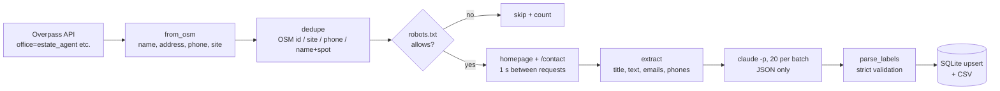

# broker-finder

Find the real-estate offices in one US county and turn them into a clean, de-duplicated lead table:
OpenStreetMap (Overpass API) → a polite homepage scrape that reads `robots.txt` first → Claude labels each
office → normalize + dedupe → SQLite + CSV.

**Demo project, not client work.** The code in this repo carries only fictional sample data; real run
outputs (`offices.db`, `offices.csv`, `run.json`, `run.log`) are git-ignored and never committed.

Demo video (6:48, a real run with the bug fixes it needed):
https://drive.google.com/file/d/1PpWR3EvmfXC8EXZ7WEydNWWjW4SIwRcd/view?usp=sharing



## What it does

| Step | Code | Notes |
|---|---|---|
| Find offices | `overpass()` | `office=estate_agent`, `shop=estate_agent`, `office=property_management` inside one county. Falls through public Overpass mirrors on 502/504. |
| Clean | `norm_phone()`, `norm_site()`, `valid_email()` | Phones to E.164, sites to `host/path`, emails must be real contacts (not Sentry DSN keys or `logo@2x.png`). |
| Dedupe | `dedupe()` | Same OSM id, website, phone, or same name within ~11 m = one office; later rows fill the first row's gaps. |
| Scrape politely | `robots_allows()`, `scrape()` | Reads `robots.txt` before every page, fetches the homepage and one same-site contact page only, 1 s between requests, identifies itself with a User-Agent. |
| Classify | `ask_claude()`, `parse_labels()` | One `claude -p` call per 20 offices. The reply must be a JSON array of `{id, category}` with ids from that batch and a category from a fixed set; anything else becomes `unknown` instead of crashing or inventing a label. |
| Store | `save()` | SQLite upsert on `osm_id` (re-running a county updates, never duplicates) and a CSV export. |

## A real run (Wake County, NC, 15 Oct 2026)

`run.json` from the run shown in the video (the scraped rows themselves are not in this repo):

```
fetched 75 named offices   deduped 1 -> 74 unique
19 sites tried: scraped 12, robots_skipped 3, fetch_failed 4
classified 74/74, unknown 0   147.0 s
```

Fixes the real runs forced (3 and 4 are covered by `check.py`):

1. macOS system Python links LibreSSL 2.8.3, which `overpass-api.de` rejects at the TLS handshake: the script exits with a clear message and runs on Python 3.12 (OpenSSL 3).
2. The main Overpass server returned 502/504 when busy: fall through the public mirrors with a back-off.
3. A Wix site yielded 7 "emails" that were Sentry DSN keys (`<32 hex>@sentry.io`): rejected in `valid_email()`.
4. Two OSM nodes for one office (same name, different case, same spot, no site or phone) were kept twice: dedupe also by name + location.

## Run it

Requirements: Python 3.12 (stdlib only, no `pip install`) and, for classification, the
[Claude Code](https://docs.claude.com/en/docs/claude-code) CLI signed in (`claude -p`).

```bash
python3.12 check.py                                         # self-check of the data rules -> ok
python3.12 broker.py "Wake County" "North Carolina" --limit 40
```

Outputs `offices.db`, `offices.csv` and `run.json` in the current folder. See
`sample/offices.sample.csv` for the shape of the CSV (fictional rows) and
`sample/overpass-element.sample.json` for one input element.

## Tests

`check.py` is an assert-based self-check (no framework): phone/site/email normalization, the Sentry-key
and image-name email junk, dedupe by website, by phone through a merged row and by name + spot, strict
parsing of Claude's reply (a bad category or prose becomes `unknown`), and the sample element. CI runs it
on every push.

## Choices and limits

- **Data source:** OpenStreetMap via the Overpass API (ODbL; credit "© OpenStreetMap contributors"). Coverage is whatever OSM volunteers mapped, so it is not a complete list of every office.
- **Scraping is deliberately small:** homepage + one contact page per site, `robots.txt` honoured, 1 s delays, a run limit. It is not a crawler. Check each site's terms before using the data commercially.
- **Classification** uses the local Claude Code CLI so the demo needs no API key in the code; swapping in the Anthropic SDK is a one-function change in `ask_claude()`.
- Personal data: it collects only business contact details published on business pages and in OSM.

## License

MIT. Demo project by McKeen Asma, not client work.
